## Plano geral das aulas {.smaller}

| | Sessão 1 | Sessão 2 |
|---|-------|-------|
| Foco | Conceitos e uma demonstração | Práticas |
| Condução | Felipe Lamarca | Tales Mançano |
| Pergunta | O que muda quando o modelo pode agir? | Como manter rigor, registro e revisão? |
| Roteiro | LLMs como agentes; modelos e formas de usar; delegar e verificar; demonstração; *harness* e regra | Orientar com prosa; garantir com código; pesquisa com repositório; outras soluções |

São 90 minutos em cada sessão. Ninguém precisa instalar nada: quem opera as ferramentas são os ministrantes.

## Antes de começar

::: {.columns}
::: {.column width="40%"}
{width=100%}
:::
::: {.column width="60%"}
Aponte a câmera do celular para o código.

Quatro perguntas, cerca de um minuto. A enquete é anônima, e só os totais aparecem na tela.

::: {.fonte}
mancano-tales.github.io/course-llm-agents-for-research/survey/
:::
:::
:::

::: notes
Deixar um minuto enquanto se apresenta. Depois, abrir `survey/results/` no projetor e comparar com a pesquisa de Lyttelton et al. Se o site ou a rede falharem, o próximo slide traz as mesmas perguntas para mão levantada.
:::

## As perguntas

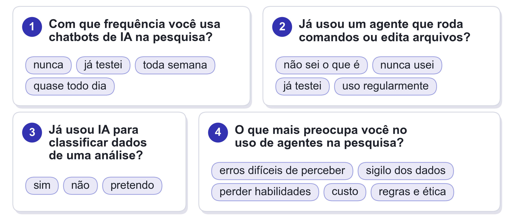{width=100%}

::: notes
Plano B, sem celular ou sem rede: ler uma pergunta por vez e pedir mão levantada para cada opção. Com o site funcionando, este slide só mostra o que está sendo perguntado.
:::

## A tese de hoje

Os agentes já são muito bons em muitas tarefas de pesquisa. A pergunta deixou de ser se vale a pena usar.

::: {.tese}
O gargalo da pesquisa com agentes deixou de ser a execução e passou a ser a verificação.
:::

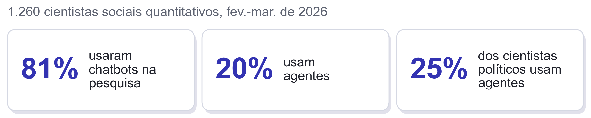{width=100%}

::: {.fonte}
Lyttelton, Massenkoff e Wilmers, *Coding Agents in the Social Sciences*, Anthropic Research, 27 maio 2026.
:::

::: notes
Quem pesquisa continua responsável pelo resultado; o agente muda o que precisa ser verificado e como. A data importa, porque esses números mudam rápido. A amostra não é representativa: os respondentes foram recrutados com a oferta de contas Claude Max.
:::

# 1. LLMs como agentes

## Do chat ao loop

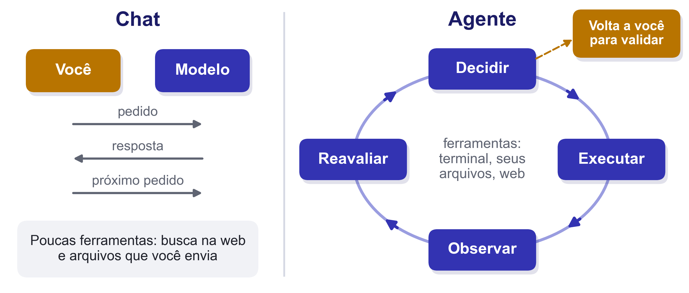{width=100%}

::: {.tese}
Um agente é um LLM que roda ferramentas em loop para atingir um objetivo.
:::

::: {.fonte}
Simon Willison (2025); Anthropic, *Building Effective Agents* (2024).
:::

## O modelo pede, o *harness* executa

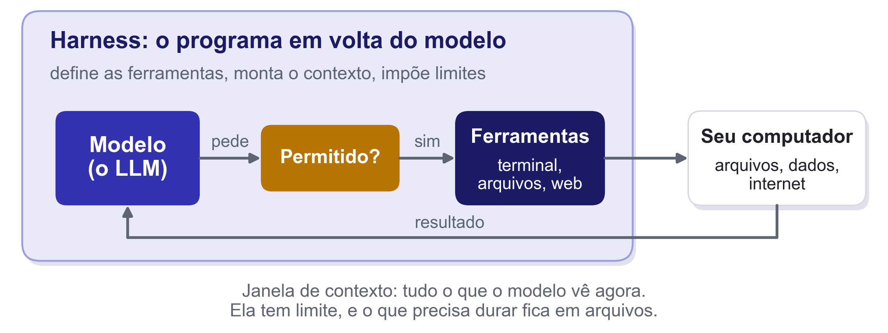{width=100%}

::: {.tese}
O que o modelo consegue fazer depende das ferramentas que o *harness* oferece. O chat também é um *harness*, com poucas.
:::

::: notes
Ponto do Galdino: o *harness* tem a ver com as ferramentas disponíveis para o modelo. No chat, ele até faz buscas, mas é muito limitado; no agente, roda código, lê e edita os seus arquivos. Com isso, você passa a conferir o resultado de um processo inteiro. O modelo é o motor; o *harness* é o carro, com freio, cinto e retrovisor. O mesmo modelo se comporta de forma diferente em *harnesses* diferentes. Nomes que a turma pode ter ouvido: Claude Code, Codex, Antigravity CLI, OpenCode, Cursor.
:::

# 2. Modelos e formas de usar

## Famílias de modelos nov/2026 {.smaller}

| Fornecedor | Linha atual | Na pesquisa |
|-----|----------|--------|
| Anthropic | Claude Fable 5.1, Opus 5.5, Sonnet 5.5, Haiku 5.5 | Base do Claude Code |
| OpenAI | GPT-6 Astra, GPT-6.1 Sol e Terra, GPT-6 Luna | Base do Codex; Luna é barato |
| Google | Gemini 4 Argon, Gemini 3.8 Flash | Contexto longo |
| Pesos abertos | DeepSeek, Qwen, Kimi, Mistral Large 4 | Rodam fora do fornecedor |

**Pesos abertos:** modelo que se pode baixar e guardar. Modelos fechados são atualizados e aposentados pelo fornecedor.

::: {.alerta}
Nomes e preços mudam em semanas.
:::

::: notes
Conferido nas páginas oficiais em 09/11/2026. O Gemini 4 Argon dobra de preço em 01/12/2026 e o Gemini 3.8 Flash em 01/01/2027. O Mistral Large 4 tem pesos abertos sob licença própria da Mistral. Desde 18/06/2026, o Gemini CLI não atende mais as assinaturas AI Pro e Ultra, e o caminho indicado pelo Google é o Antigravity CLI.
:::

## Três janelas, o mesmo agente

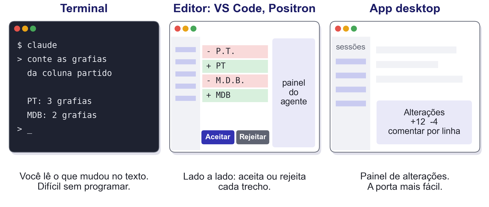{width=100%}

O *diff* é o que mudou, linha a linha.

::: notes
O esquema descreve o Claude Code; Codex e Antigravity têm equivalentes. Sem terminal, o Cowork (Anthropic) só acessa as pastas conectadas. Na nuvem: o terminal usa `--cloud`, o VS Code retoma uma cópia local e o app escolhe entre local, nuvem e SSH. No Positron, o assistente nativo agora se chama Posit Assistant (desde a versão 2026.07). Para quem usa R, vale citar `ellmer`, `mall`, `mcptools` e `btw`, sem demonstrar.
:::

## Tour: uma tarefa em três janelas {.smaller}

**Tarefa:** padronizar as grafias de partidos em um CSV fictício.

| Janela | Modo | O que olhar |
|---|---|---|
| Terminal | Plan | O agente conta as grafias e propõe, sem alterar nada |
| VS Code | Manual | Aceitar um trecho e rejeitar outro |
| App | Manual | Abrir o *diff* e comentar uma linha |

::: {.tese}
A tarefa é a mesma. Muda o quanto você vê antes de aceitar.
:::

::: notes
Três minutos. Repositório com Git, sem conectores: `lab/tour-interfaces/partidos.csv`. Forçar o modo Manual, porque o Auto é o modo inicial em terminal e VS Code e aplicaria sem mostrar. Deixar as sessões prontas, paradas na aprovação, e usar perfil limpo, porque a barra lateral do app mostra projetos reais. O trecho a rejeitar é o que junta PMDB e MDB: trata-se de decisão de pesquisa, e o agente não deveria tomá-la sozinho. Contingência: 20 segundos sem resposta, passar adiante.
:::

# 3. Delegar e verificar

## O que mudou desde 2025

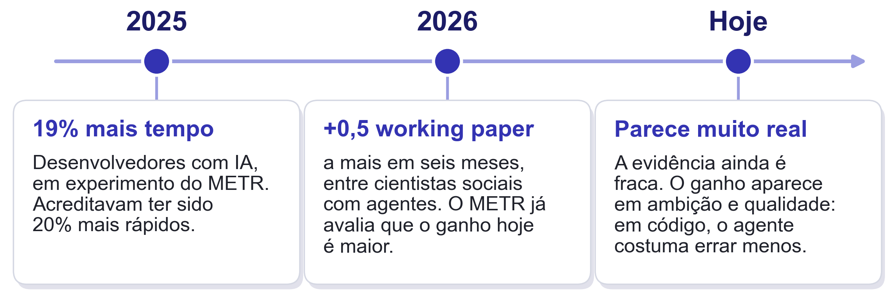{width=100%}

::: {.tese}
A dúvida deixou de ser se vale a pena usar. Passou a ser como usar bem.
:::

::: {.fonte}
Becker et al. (METR, jul. 2025); METR (fev. 2026); Lyttelton, Massenkoff e Wilmers (maio 2026), descritivo e em amostra não representativa. O quadro "Hoje" é avaliação dos ministrantes.
:::

::: notes
Em 2025, o ganho parecia mais percepção do que realidade. Em 2026, o METR registra que muitos desenvolvedores já não aceitavam participar do experimento sem IA. Objeções como "papagaio estocástico" ou o erro de contar letras em *strawberry* descrevem modelos de anos atrás. Quem fica de fora hoje faz uma escolha consciente. Sem evidência sistemática, para dizer como impressão: os apêndices dos *working papers* estão maiores? Há relatos de pesquisadores revisando os próprios artigos antigos com agentes. O ganho de qualidade não dispensa a verificação, que é o tema dos próximos slides. Na pesquisa com cientistas sociais, a adoção também é desigual por gênero e por prestígio da instituição.
:::

## Quanto custa? nov/2026

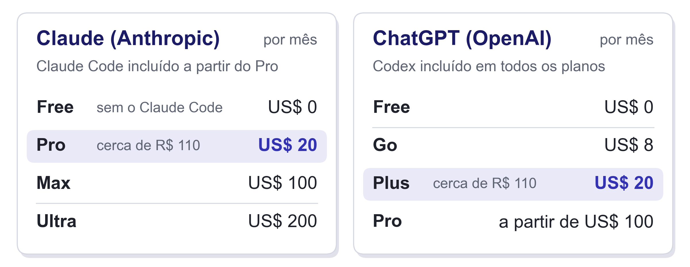{width=100%}

**Via API**, paga-se por volume: codificar 2.000 discursos custa de US$ 0,60 a US$ 60, conforme o modelo.

::: {.fonte}
Páginas oficiais de preços, consultadas em 09/11/2026. Dólar a R$ 5,51 (PTAX de venda de 09/11/2026).
:::

::: notes
As assinaturas têm limite de uso, e o tempo de validação humana domina o custo total. No Claude, o plano Free não inclui o Claude Code, e o Pro sai por US$ 17 ao mês no plano anual. No ChatGPT, todos os planos incluem o Codex, e o Pro tem faixas de US$ 100, 200 e 500. Conta via API: 2.000 discursos de cerca de 2.000 tokens, com rótulo curto e sem *batch* (4 milhões de tokens de entrada e 0,4 milhão de saída). Sai por US$ 0,60 com GPT-6 Luna ou Claude Haiku 5.5, US$ 4,50 com Gemini 3.8 Flash, US$ 12 com Claude Sonnet 5.5 ou GPT-6.1 Sol, US$ 24 com Claude Opus 5.5 e US$ 60 com GPT-6 Astra. Em lote, metade. Raciocínio é cobrado como saída, então os valores são piso. Reconferir preços e câmbio na véspera.
:::

## O custo caiu de um lado só

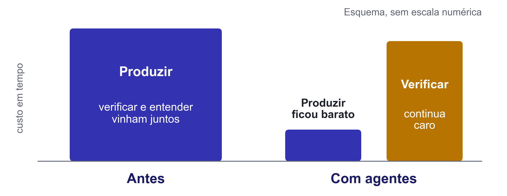{width=92% fig-align="center"}

::: {.fonte}
Scott Cunningham, série "Claude Code", post 44 (abr. 2026), e "Where and how will the human be in the loop?" (set. 2026).
:::

::: notes
Ao fazer a pesquisa nós mesmos, ganhávamos verificação e entendimento de graça. Ao delegar, esse subproduto some.
:::

## A matriz de perigo

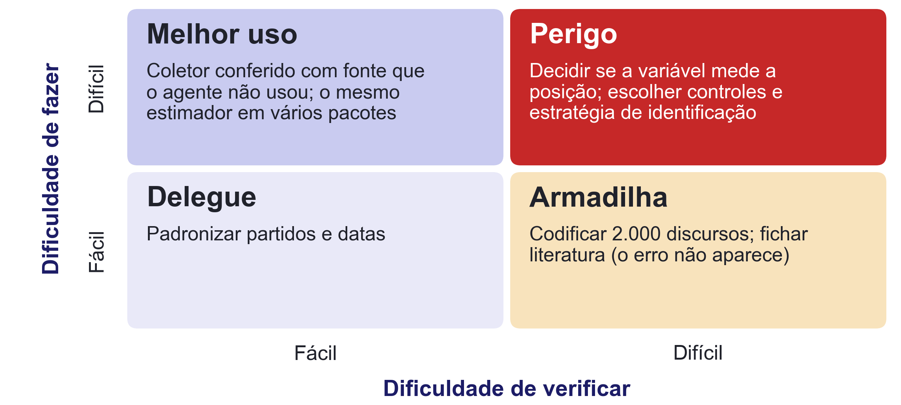{width=100%}

::: {.tese}
Quanto mais difícil de fazer e de verificar, maior o risco de delegar.
:::

::: notes
"Difícil" significa exigir conhecimento especializado. Dar trabalho é outra coisa: codificar 2.000 discursos dá muito trabalho, mas cada discurso, isolado, é simples. Sobre a Armadilha: amostrar resolve o volume, mas não o erro correlacionado com a variável de interesse, e LLMs usam pistas partidárias para julgar textos políticos (Vallejo Vera e Driggers, 2024). Em simulação, com 90% de acurácia, um intervalo de 95% cobre só 40% quando se ignora o erro de medida (Egami et al., 2023). Uma tarefa sai da Armadilha com amostra de validação cega: com as sugestões do LLM à vista, anotadores mudam os rótulos (Schroeder, Roy e Kabbara, 2025), e outro modelo não é revisor independente (Kim et al., 2025).
:::

## O que não delegar

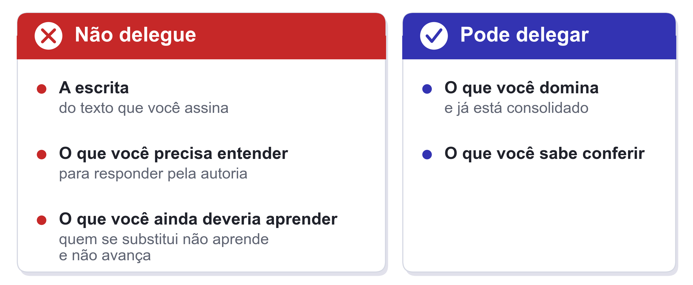{width=100%}

::: {.tese}
Depende do que você sabe sobre o que está delegando.
:::

::: notes
Para responder pela autoria, você precisa entender, e às vezes isso pede fazer uma etapa à mão. A matriz é relativa a quem delega: a mesma tarefa cai em quadrantes diferentes para pessoas diferentes. Delegar o que você deveria aprender é ruim porque você não aprende. O que você sabe bem e considera consolidado pode ser delegado sem problema. Scott Cunningham proibiu IA nos próprios cursos de 2026 pelo mesmo motivo.
:::

## Quem responde {.smaller}

- **CNPq** (Portaria 2.664/2026): declarar ferramenta e finalidade, em qualquer fase; autores integralmente responsáveis
- **AJPS:** declarar uso em dados, código e análise, com a supervisão aplicada; omitir é motivo de recusa
- **Ética:** entrevistas identificadas seguem sob CEP e LGPD

::: {.tese}
Quem assina responde, inclusive pelo que o agente produziu.
:::

::: notes
Pela Resolução CNS 510/2016, pesquisa com informação de acesso público dispensa CEP; entrevistas identificadas, não. A LGPD excetua fins acadêmicos, mas mantém a base legal (arts. 7º e 11). A política da AJPS também pede ferramenta, versão quando disponível e datas aproximadas.
:::

# 4. Demonstração

## Da pergunta à ficha

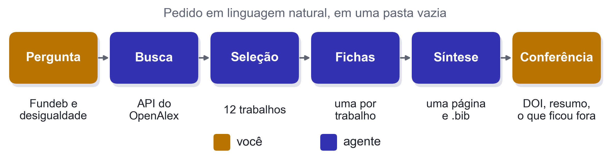{width=100%}

> Mapeie a literatura brasileira recente sobre Fundeb e desigualdade. Use a API do OpenAlex, selecione os 12 trabalhos mais pertinentes, faça uma ficha de cada um (pergunta, método, achado, limitação), gere um `.bib` e uma síntese de uma página, e me diga o que ficou de fora e por quê.

::: notes
Roteiro em `lab/demo-literature/README.md`. Rodar no VS Code, em pasta vazia e com configuração limpa. Dizer em voz alta que não há instruções permanentes, *skills* nem *hooks*: como isso vira um protocolo repetível é a aula do Tales. A síntese pedida é material de leitura para quem pesquisa; o texto do artigo continua sendo seu.
:::

## O que conferir

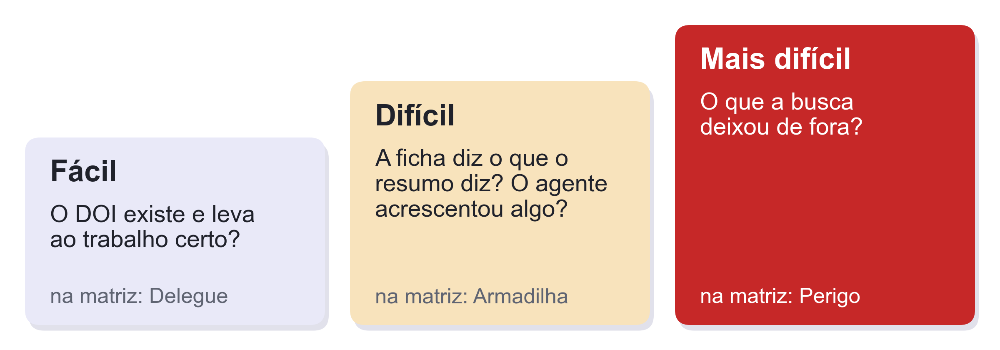{width=100%}

::: {.tese}
O agente entrega fichas. Quem decide se elas valem é você.
:::

::: notes
Conferir ao vivo: abrir um DOI; abrir uma ficha ao lado do resumo original; trocar um termo da busca ou a ordenação e comparar as listas.
:::

## Cada etapa decide o que fica de fora

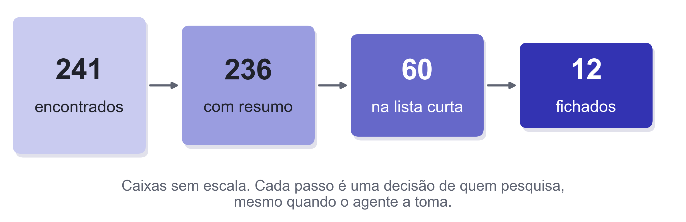{width=100%}

Trocar um termo da busca ou a ordenação muda a lista.

::: {.fonte}
Execução de preparação desta demonstração, em nov. de 2026, com a API do OpenAlex.
:::

::: notes
Números da execução de preparação, em `lab/demo-literature/backup/`: duas buscas no OpenAlex (185 e 127 resultados, 241 únicos), a partir de 2018, por título e resumo. Entre os 236 com resumo, 3 não são resumo de fato. Uma busca por relevância com outros termos, para 2020 a 2026, trouxe 2.518 resultados: esse é o ponto do slide.
:::

# 5. Limites: *harness* e regra

## Quem decide? nov/2026

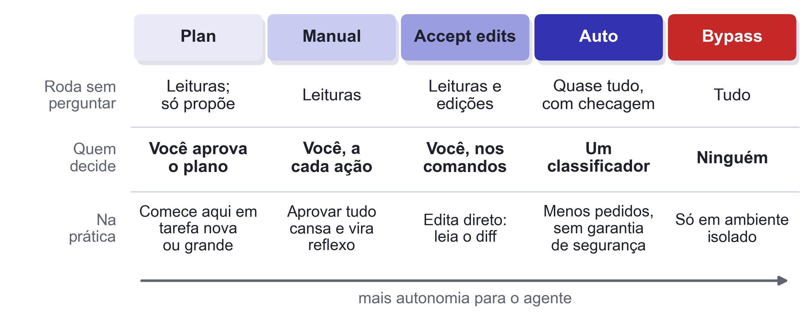{width=100%}

::: {.tese}
Escolher o modo é escolher quem decide.
:::

::: {.fonte}
Documentação do Claude Code, *Permission modes* (consultada em 09/11/2026). Outros *harnesses* têm equivalentes.
:::

::: notes
Para tarefa nova ou grande, vale começar pelo modo de planejamento: o agente propõe, e você aprova antes de qualquer alteração. Desde a versão 2.1.283, o Auto é o modo inicial em terminal e VS Code. O próprio fabricante diz que ele reduz os pedidos de permissão sem garantir segurança. Autonomia total só em ambiente isolado, como um contêiner ou uma máquina virtual: se algo der errado, apaga-se o ambiente, e o computador fica intacto.
:::

## Um caso real: o e-mail

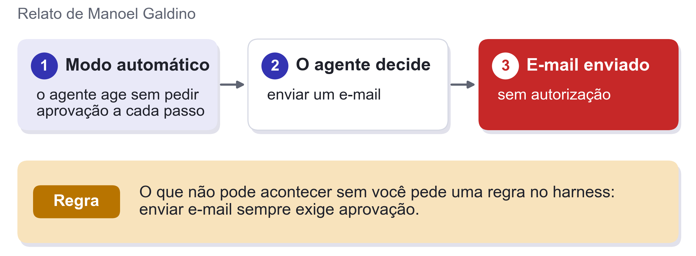{width=100%}

::: {.tese}
Autonomia sem regra depende de o agente acertar sempre.
:::

::: notes
Contar o caso em primeira mão, se o Galdino estiver na sala. O e-mail é uma saída para o exterior, e esse tipo de ação é o que mais pede regra. Simon Willison chama de "tríade letal" a combinação de dados privados, conteúdo não confiável e comunicação com o exterior no mesmo agente: a recomendação é cortar pelo menos uma das três. A Sessão 2 retoma esse ponto.
:::

## Prosa e regra

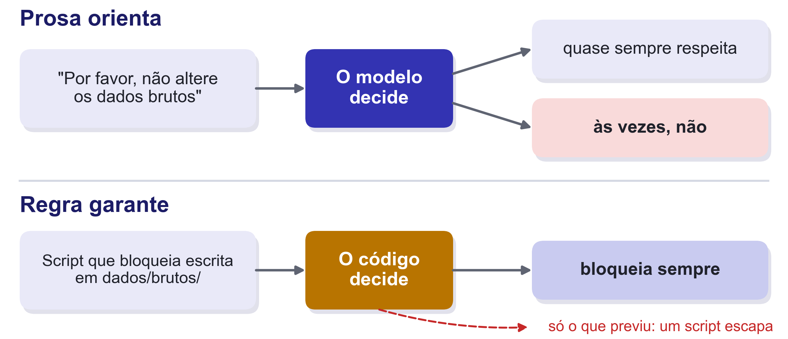{width=94% fig-align="center"}

::: {.tese}
As instruções mudam o que o agente tenta. O *harness* decide o que ele pode.
:::

::: notes
O `AGENTS.md` é o arquivo com as instruções do projeto. Um script escrito pelo agente pode abrir o arquivo que a regra protege. Quem procurar *code as policy* vai cair em Liang et al. (2022), da robótica, em que o modelo gera o programa que controla o robô. No uso atual com agentes, somos nós que escrevemos as regras que limitam o modelo. As camadas de proteção são tema da Sessão 2.
:::

## Por que a pesquisa precisa de regra {.smaller}

1. **Variância:** mesmo modelo, mesmo *prompt*, respostas diferentes em dias diferentes. Modelos fechados também são aposentados
2. **Estável não é válido:** um modelo local quase sem variância pode errar mais
3. **"LLM hacking":** modelo e *prompt* levam a conclusão errada em cerca de **31%** das hipóteses com modelos de ponta e na **metade** com modelos menores
4. **Validade da medida:** o erro de classificação enviesa a regressão; a saída é uma amostra de validação humana com estimadores que corrigem o viés

::: {.alerta}
Dados brutos, formato das variáveis, registro do que foi feito e amostra de validação pedem regras executáveis.
:::

::: {.fonte}
Barrie, Palmer e Spirling (2025), manuscrito; Baumann et al. (2025), preprint; Egami et al. (2023); Ludwig, Mullainathan e Rambachan (2026).
:::

::: notes
Essas regras são os *guardrails* da Sessão 2. Em Barrie, Palmer e Spirling, tabela 1: código e dados estáticos replicam exatamente, mas dependem do sistema; uma regra explícita de codificação replica sem depender de computador; *crowdsourcing* não replica exatamente, mas não depende do sistema; o LLM não replica exatamente e ainda depende do modelo e da versão.
:::

## Para levar {.smaller}

1. **Agente = modelo + harness + loop.** O *harness* decide o que ele pode fazer
2. Antes de delegar, pergunte: **como eu saberia que está errado?**
3. O que afeta **validade e replicação** se protege com regra

**Para a Sessão 2:** o que precisa estar no projeto antes de o agente começar?

**Entre as sessões:** Korinek (2025), *AI Agents for Economic Research*, introdução; um texto da série de Cunningham.

Materiais: [github.com/mancano-tales/course-llm-agents-for-research](https://github.com/mancano-tales/course-llm-agents-for-research)

Continua no PDF da Sessão 2: *Habilidades práticas e governança*.
